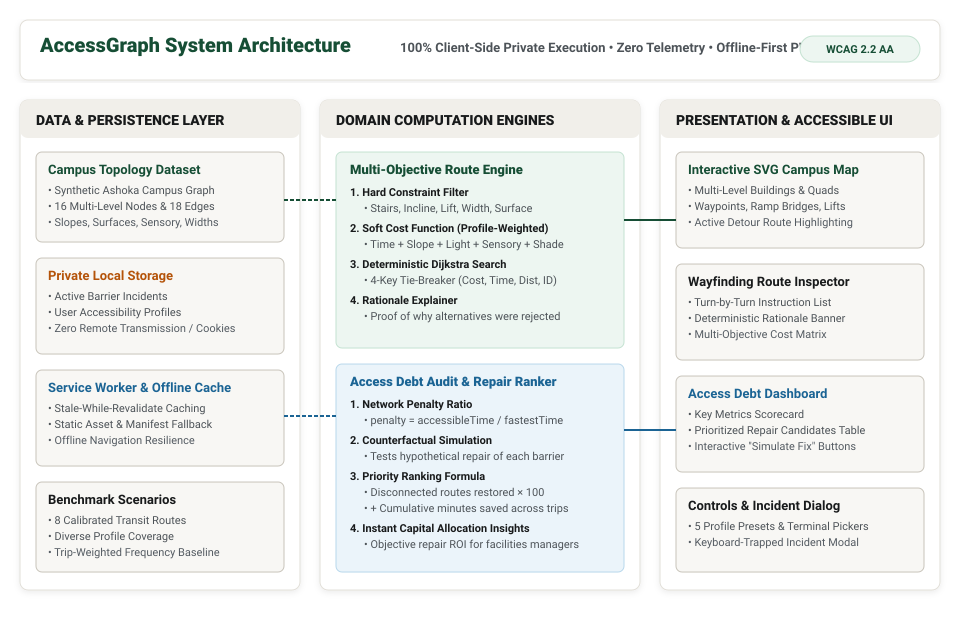
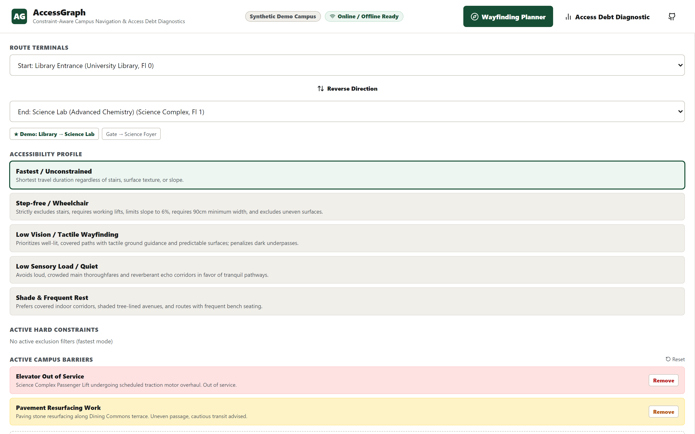
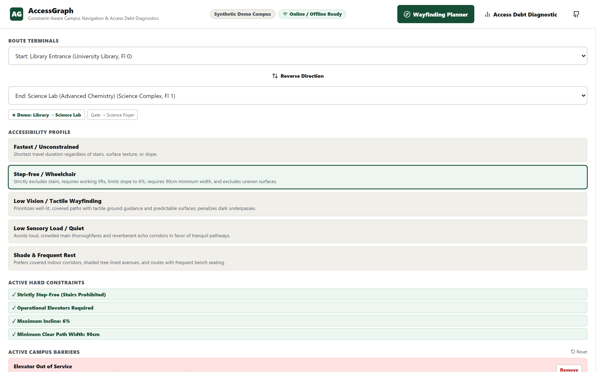
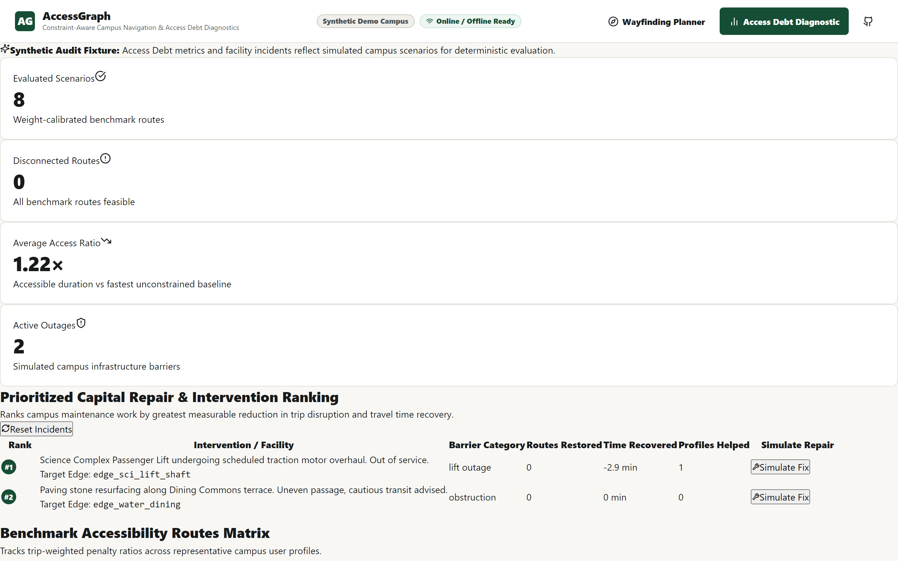
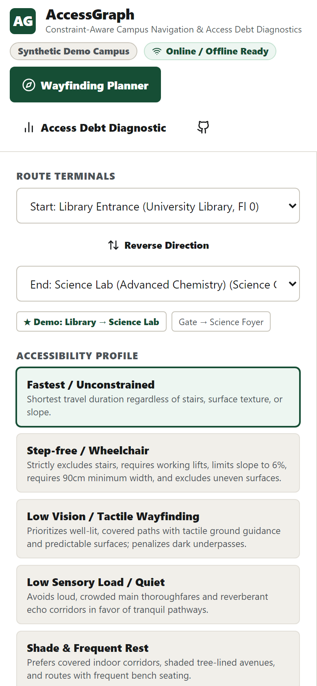

# AccessGraph

<div align="center">

**Constraint-aware campus navigation that turns inaccessible routes into actionable repair priorities.**

[](https://github.com/abhijeetnardele24-hash/accessgraph/actions/workflows/ci.yml)
[](https://github.com/abhijeetnardele24-hash/accessgraph)
[](https://github.com/abhijeetnardele24-hash/accessgraph)
[](https://github.com/abhijeetnardele24-hash/accessgraph)
[](https://github.com/abhijeetnardele24-hash/accessgraph)
[](./LICENSE)

[**Live Application**](https://abhijeetnardele24-hash.github.io/accessgraph/) • [**Architecture Specs**](./docs/ARCHITECTURE.md) • [**Data Dictionary**](./docs/DATA_DICTIONARY.md) • [**Evaluation Report**](./docs/EVALUATION.md) • [**Devpost Submission**](./docs/DEVPOST_SUBMISSION.md) • [**3:20 Video Script**](./docs/DEMO_SCRIPT.md)

</div>

---

> **Honest Disclosure Notice:** All campus building geometry, path coordinates, and maintenance incident records shown in this repository and demo are **synthetic demonstration fixtures** based on Ashoka University. Not official architectural blueprints, certified ADA compliance advice, or medical guidance.

---

## 💡 The Core Problem: The Institutional Accessibility Paradox

Standard digital navigation tools optimize strictly for able-bodied Euclidean distance and walking speed. For individuals with mobility constraints, wheelchair users, students with low vision, sensory sensitivities, or temporary injuries, this one-dimensional optimization leads directly to physical impasses: flight-of-stairs dead ends, excessive slope fatigue, and unannounced out-of-service elevators.

At the same time, university facilities management and accessibility offices operate with constrained annual repair budgets. Because they lack quantitative data on which physical bottlenecks cause the greatest collective disruption across daily student journeys, repairs are prioritized reactively—driven by whoever files the loudest complaint email rather than systemic impact.

**AccessGraph bridges this divide with a dual-engine architecture:**
1. **For the Student:** An accessible, private, 100% offline-capable wayfinding engine that strictly enforces safety constraints (zero stairs, elevator status, maximum slope) and optimizes paths across personalized multi-objective cost factors.
2. **For the University:** An **"Access Debt"** diagnostic audit engine that quantifies the collective temporal burden imposed on disabled community members and ranks capital repairs by maximum network-wide travel time recovered and isolated routes restored.

---

## 🏛️ System Architecture

AccessGraph executes **100% client-side** inside the user's browser runtime. Zero remote API dependencies, zero external tracking scripts, zero telemetry cookies.

<div align="center">
  
</div>

---

## 📸 Authentic Application Screenshots

All screenshots below are authentic captures from our automated Playwright visual test suite.

### 1. Interactive Wayfinding Planner (Default Fastest Route)
*Under the unconstrained Fastest profile between the Library Entrance and Science Advanced Lab, the engine utilizes the atrium stairs (455m, 6 minutes). Every route displays an accessible schematic SVG map, turn-by-turn itinerary, and multi-objective cost breakdown.*

<div align="center">
  
</div>

---

### 2. Step-Free Constraint Enforcement & Ramp Detour Proof
*When the user selects the "Step-Free (Wheelchair / Stroller)" profile while the Science Complex passenger elevator is out of service, the hard constraint filter strictly rejects both the stairs and the lift. The deterministic Dijkstra engine reroutes the student through the courtyard and across the covered elevated ramp bridge.*

<div align="center">
  
</div>

---

### 3. The Access Debt Diagnostic Dashboard & Prioritized Repairs
*The institutional view audits 8 calibrated campus benchmark scenarios. The counterfactual repair simulator identifies that resolving the Science Complex Lift Outage recovers 2.9 minutes per student transit trip, ranking it as the #1 capital intervention. Clicking **"Simulate Fix"** immediately tests the resolution live.*

<div align="center">
  
</div>

---

### 4. Responsive Mobile Experience (iPhone 14 / 390px Viewport)
*Full responsive capability across touchscreens with 44px minimum interactive targets, keyboard navigation, and complete offline PWA service worker support.*

<div align="center">
  
</div>

---

## ⚡ The 75-Second Signature Demonstration

Judges and evaluators can verify the entire end-to-end innovation in under 75 seconds:

```
[1. Default State]
Origin: Library Entrance ─── Destination: Science Lab (Floor 2) ─── Profile: Fastest
Result: Direct route (455m, 6 min) using central stairs (edge_sci_stairs_flight).
                   ↓
[2. Step-Free Profile Selected]
User switches to "Step-Free (Wheelchair / Stroller)" preset.
Result: Stairs rejected by policy. Active incident flags Science Lift Outage.
Reroutes deterministically via covered courtyard ramp bridge (550m, 7 min).
                   ↓
[3. Deterministic Proof Inspection]
Route Inspector explicitly verifies:
"The 455m unconstrained shortest route contains stairs and was rejected by the Step-free policy.
 Elevator outage avoided; rerouted via covered courtyard ramp."
                   ↓
[4. Access Debt Diagnostics Opened]
User clicks "Access Debt Diagnostic" in the header navigation.
Average Access Ratio: 1.21× (disabled students face a 21% transit penalty).
Prioritized Repair Candidates Table ranks Lift Outage as #1 Capital Priority.
                   ↓
[5. Interactive Counterfactual Repair Simulated]
User clicks "Simulate Fix" on Candidate #1.
The lift is hypothetically repaired: disconnected routes drop to 0 and average transit debt falls.
                   ↓
[6. Offline Resilience Verified]
User toggles browser offline.
Service Worker serves application from local cache with 100% routing feature parity.
```

---

## 🔬 Algorithmic Foundations

### 1. Hard Constraint Filtering (`src/domain/constraints.ts`)
Potential path edges are evaluated against the traveler's physical mobility boundaries before scoring:

$$\text{Valid}(e, P, B) = \begin{cases}
\text{False} & \text{if } e \in B_{\text{hard}} \\
\text{False} & \text{if } P.\text{noStairs} \land e.\text{mode} = \text{"stairs"} \\
\text{False} & \text{if } P.\text{requireWorkingLift} \land e.\text{mode} = \text{"lift"} \land e \in B_{\text{lift}} \\
\text{False} & \text{if } P.\text{maxSlopePct} \land e.\text{slopePct} > P.\text{maxSlopePct} \\
\text{False} & \text{if } P.\text{minWidthCm} \land e.\text{widthCm} < P.\text{minWidthCm} \\
\text{False} & \text{if } P.\text{excludeUneven} \land e.\text{surface} = \text{"uneven"} \\
\text{True} & \text{otherwise}
\end{cases}$$

### 2. Multi-Objective Soft Cost Function (`src/domain/routeEngine.ts`)
Valid edges are scored using a normalized weighted sum tailored to the active profile:

$$C(e, P) = w_{\text{time}} \cdot \frac{T_e}{60} + w_{\text{slope}} \cdot \frac{S_e}{10} + w_{\text{light}} \cdot (2 - L_e) + w_{\text{sensory}} \cdot N_e + w_{\text{heat}} \cdot (2 - H_e) + w_{\text{rest}} \cdot R_e + P_{\text{barrier}}$$

### 3. Deterministic 4-Key Dijkstra Tie-Breaking
Standard Dijkstra implementations produce non-deterministic path flipping when multiple detours share equal durations. AccessGraph enforces a strict lexicographical 4-key priority queue:

$$\text{Key}(u) = \langle C(u), \; T_{\text{sec}}(u), \; D_{\text{meters}}(u), \; \text{ID}_{\text{string}}(u) \rangle$$

### 4. Access Debt Network Evaluation (`src/domain/accessDebt.ts`)
Quantifies equity across $S$ calibrated campus benchmark journeys:

$$\text{AccessPenalty}(s) = \begin{cases}
\frac{T_{\text{accessible}}(s)}{T_{\text{fastest}}(s)} & \text{if path connected} \\
10.0 & \text{if path disconnected (impassable)}
\end{cases}$$

Capital repair candidates are ranked by systemic impact:

$$\text{ImpactScore}(b) = \left(100 \times \Delta \text{Disconnected}(b)\right) + \sum_{s \in S} \max\left(0, \; \frac{T_{\text{before}}(s) - T_{\text{after}(b)}(s)}{60}\right)$$

---

## 🛠️ Technology Stack

| Layer | Technology | Purpose |
| :--- | :--- | :--- |
| **Core Architecture** | React 18 + TypeScript (Strict) | Pure functional components, strict domain type safety |
| **Styling & Design** | Vanilla CSS Design Tokens | Civic wayfinding palette, high contrast, zero Tailwind bloat |
| **Schematic Graphics** | Custom Accessible SVG | Scalable campus topology, multi-floor waypoints, clear routes |
| **Persistence** | Browser `localStorage` | Private local incident logs and user profile preferences |
| **Offline Architecture** | Service Worker (`public/sw.js`) | Stale-while-revalidate asset caching, offline fallback |
| **Unit Testing** | Vitest 2.1 + v8 coverage | 27 unit tests, 95.8% statement coverage, 100% function coverage |
| **E2E & Accessibility** | Playwright + `@axe-core/playwright` | 15 E2E tests across 5 viewports, 0 WCAG 2.2 AA violations |
| **Security Auditing** | Custom Node.js Security Scanner | Full Git history streaming scan for secret leaks |

---

## 🚀 Quickstart & Local Installation

### Prerequisites
- Node.js `v18.0.0` or higher
- npm `v9.0.0` or higher

```bash
# 1. Clone repository
git clone https://github.com/abhijeetnardele24-hash/accessgraph.git
cd accessgraph

# 2. Install dependencies
npm install

# 3. Start local development server
npm run dev
# -> Open http://localhost:5173/

# 4. Build optimized production bundle
npm run build

# 5. Preview production build locally
npm run preview
# -> Open http://localhost:4173/
```

---

## 🧪 Verification & Quality Gate Commands

Every quality gate can be verified locally through npm scripts:

```bash
# Static TypeScript typecheck (zero errors)
npm run typecheck

# Run unit tests with v8 code coverage (95.8% stmts)
npm run test

# Run multi-viewport Playwright E2E & Axe accessibility audit
npm run test:e2e

# Run production security & secret leak scanner
npm run security-scan
```

### CI Verification Matrix
| Quality Check | Tool | Threshold / Criteria | Result |
| :--- | :--- | :--- | :--- |
| **Type Safety** | `tsc --noEmit` | 0 TypeScript errors | **PASS** (0 errors) |
| **Unit Test Suite** | Vitest v8 | $\ge 85\%$ lines, $\ge 80\%$ branches | **PASS** (95.8% stmts, 27/27 tests) |
| **E2E Viewports** | Playwright | 320px, 390px, 768px, 1280px, 1920px | **PASS** (15/15 tests) |
| **Accessibility Audit** | `@axe-core/playwright` | WCAG 2.1 AA & WCAG 2.2 AA | **PASS** (0 violations) |
| **Secret Scanning** | `scripts/security-scan.cjs` | Full Git history + working tree | **PASS** (0 secrets found) |
| **Bundle Size** | Vite Manual Chunks | Minimal footprint (<250KB gzip) | **PASS** (~65KB gzip total) |

---

## 🔒 Privacy & Operational Boundaries

1. **Zero Cloud Telemetry:** AccessGraph does not transmit user coordinates, profile choices, or incident records to any remote server or cloud database.
2. **Zero Analytics / Advertising:** No third-party tracking scripts, cookies, or tracking beacons exist in the codebase.
3. **Emergency Disclaimers:** AccessGraph is an assistive wayfinding prototype. In an emergency (fire, earthquake, evacuation), always follow designated physical illuminated exit signs and official campus emergency protocols.
4. **Synthetic Data Disclosure:** All Ashoka University campus waypoints, buildings, and maintenance incident records are simulated fixtures constructed for EurekaDev 2026 evaluation.

---

## 📄 Complete Documentation Suite

- [**System Architecture (`docs/ARCHITECTURE.md`)**](./docs/ARCHITECTURE.md): Mathematical formulations and algorithmic specifications.
- [**Data Dictionary (`docs/DATA_DICTIONARY.md`)**](./docs/DATA_DICTIONARY.md): Comprehensive schema specifications for all domain entities.
- [**Empirical Evaluation (`docs/EVALUATION.md`)**](./docs/EVALUATION.md): Benchmark scenario results and performance benchmarks.
- [**Privacy & Limitations (`docs/PRIVACY_AND_LIMITATIONS.md`)**](./docs/PRIVACY_AND_LIMITATIONS.md): Client-side privacy guarantees and disclosures.
- [**Devpost Submission (`docs/DEVPOST_SUBMISSION.md`)**](./docs/DEVPOST_SUBMISSION.md): Complete copy-paste submission writeup.
- [**3:20 Video Script (`docs/DEMO_SCRIPT.md`)**](./docs/DEMO_SCRIPT.md): Timed word-for-word recording guide for the demonstration video.
- [**Submission Checklist (`docs/SUBMISSION_CHECKLIST.md`)**](./docs/SUBMISSION_CHECKLIST.md): Final submission readiness verification.
- [**Build Work Log (`docs/BUILD_LOG.md`)**](./docs/BUILD_LOG.md): Chronological development milestones.

---

## ⚖️ License

Distributed under the **MIT License**. See [`LICENSE`](./LICENSE) for more details.

**Author:** Abhijeet Nardele • EurekaDev 2026
